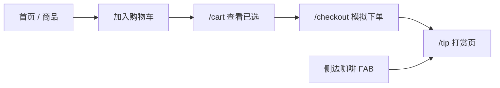
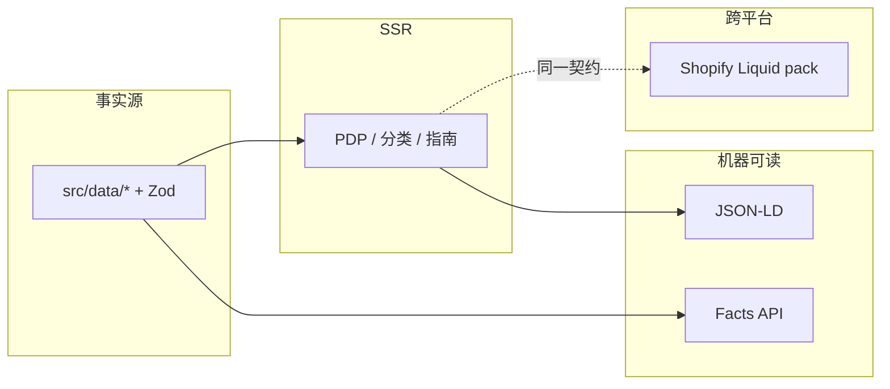

<p align="center">
  
</p>

<p align="center">
  <strong>峰途 TrailForge</strong><br/>
  <em>SEO + GEO ecommerce demo · Shopify-ready delivery pack · MIT</em>
</p>

<p align="center">
  <a href="http://117.72.122.109:3088/"></a>
  <a href="./LICENSE"></a>
  <a href="https://nextjs.org/"></a>
  
  
  <a href="./docs/shopify/"></a>
  
  
</p>

<p align="center">
  <a href="#-live-demo">🟢 Live Demo</a> ·
  <a href="#-60-秒看懂">60 秒看懂</a> ·
  <a href="#-亮点网格">亮点</a> ·
  <a href="#-模拟下单--打赏">购物车→打赏</a> ·
  <a href="#-shopify-企业交付包">Shopify</a> ·
  <a href="#-快速开始">快速开始</a> ·
  <a href="#-english">EN</a>
</p>

---

## 🟢 Live Demo

> **IP 演示已开** · 自定义域 `thisiskingsley.online` **绑定中（pending）** · 请先用下面链接体验。

| 场景 | 直达（根路径，无 `/trailforge`） |
|------|----------------------------------|
| 🏠 首页 · Hero / R3F / 咖啡 FAB | http://117.72.122.109:3088/ |
| 👟 商品列表 | http://117.72.122.109:3088/products |
| 🛒 购物车 | http://117.72.122.109:3088/cart |
| 🧾 模拟结账 | http://117.72.122.109:3088/checkout |
| ☕ 打赏页（收款码） | http://117.72.122.109:3088/tip |
| 📊 GEO 审计清单 | http://117.72.122.109:3088/audit |
| ✨ 动效实验室 | http://117.72.122.109:3088/effects |
| 🧭 Shopify SEO/GEO 指南 | http://117.72.122.109:3088/guides/shopify-seo-geo |
| 🔌 Facts API 样例 | http://117.72.122.109:3088/api/facts/ridgewalk-gtx-mid |
| ❤️ 健康检查 | http://117.72.122.109:3088/api/health |

```text
  ┌─────────────┐     ┌──────────┐     ┌───────────┐     ┌─────────┐
  │ 挑商品 / PDP │ ──▶ │  /cart   │ ──▶ │ /checkout │ ──▶ │  /tip   │
  │ + 右侧咖啡FAB│     │ 看已选   │     │ 模拟下单  │     │ 打赏支付│
  └─────────────┘     └──────────┘     └───────────┘     └─────────┘
```

手机浏览器直接开 IP 链接即可；布局为 Tailwind 响应式。域名绑好后会切到 `http://thisiskingsley.online`（HTTPS 另配）。

---

## ⚡ 60 秒看懂

这不是又一个 GEO 内容 CMS，而是 **可 fork 的店面 + 工具库 + Shopify 交付包**：

| 传统做法 | 本 Demo |
|---------|---------|
| 文案与 JSON-LD 两套稿 | `src/data/` **单一事实源**（Zod） |
| 只卷十个蓝链 | 同时面向 **AI 答案引用（GEO）** |
| 黑盒「投喂」技巧 | Answer-first · FAQ · 规格表 · [`/audit`](http://117.72.122.109:3088/audit) |
| 难交付的玩具 | Shopify Liquid 包 · 企业亮点文档 · MIT |

> Google **忽略** `llms.txt`。仓库仍提供它给其他 Agent；**不要**当成 Google AI Overviews 开关。Googlebot ≠ Google-Extended。

---

## ✨ 亮点网格

| | 能力 | 你在 Demo 里怎么验 |
|--|------|-------------------|
| 🎯 | **Answer-first SEO+GEO** | 打开任意 PDP / 分类 / 指南，首屏短答 + FAQ + 规格与 JSON-LD **同源** |
| 🛒 | **购物车 → 模拟下单 → 打赏** | [`/cart`](http://117.72.122.109:3088/cart) → [`/checkout`](http://117.72.122.109:3088/checkout) → [`/tip`](http://117.72.122.109:3088/tip) |
| ☕ | **侧边「请我喝杯咖啡」FAB** | 全站右侧悬浮入口，进打赏页（支付宝/微信收款码） |
| 🎬 | **Motion + 懒加载 R3F Hero** | 首页滚动进度 / 数字递增 / tilt / marquee；Hero 3D `next/dynamic` 不挡 SSR |
| 🧪 | **动效实验室 8 库** | [`/effects`](http://117.72.122.109:3088/effects) 按路由懒加载 Motion / GSAP / Lottie / Spring / R3F… |
| 📦 | **Shopify Liquid 交付包** | [`docs/shopify/`](./docs/shopify/) + [`INSTALL.md`](./docs/shopify/INSTALL.md) |
| 🏢 | **企业交付亮点** | [`docs/enterprise-delivery-highlights.md`](./docs/enterprise-delivery-highlights.md) |
| ✅ | **GEO 审计页** | [`/audit`](http://117.72.122.109:3088/audit) 清单打分，可对客户演示验收 |

<details>
<summary><b>首页企业动效一览（点击展开）</b></summary>

<br/>

| 模式 | 说明 |
|------|------|
| Scroll progress | 顶部 `scaleX` 跟随 `scrollYProgress` |
| Stats count-up | 进入视口后数字递增 |
| Hero parallax | 光晕与标题分层位移 |
| Section reveal | `whileInView` + blur/fade（`once`） |
| Product tilt | 轻微透视跟随指针 |
| Feature marquee | 标签带，悬停暂停 |
| Hero R3F (lazy) | `LazyHomeHero3D` → `ssr: false`，不进其他路由首包 |

`prefers-reduced-motion` 时关闭视差/递增/跑马灯，Hero 3D 退化为静态块；文案始终在 DOM 可见。

</details>

<details>
<summary><b>动效实验室路由（点击展开）</b></summary>

<br/>

| 路由 | 库 | 许可 |
|------|----|------|
| `/effects` | Hub | — |
| `/effects/motion` | [Motion](https://motion.dev/) | MIT |
| `/effects/gsap` | [GSAP](https://gsap.com/) core | 核心可商用* |
| `/effects/lottie` | lottie-react | MIT |
| `/effects/auto-animate` | Auto-Animate | MIT |
| `/effects/spring` | React Spring | MIT |
| `/effects/animate-css` | Animate.css | MIT（仅该页引入 CSS） |
| `/effects/tailwind` | Tailwind `@keyframes` | MIT |
| `/effects/r3f` | Three.js + R3F + drei | MIT |

\* 本仓库 Demo **只依赖 `gsap` 核心**。详见 [docs/blog/animation-libs.md](./docs/blog/animation-libs.md)。

</details>

---

## 🛒 模拟下单 → 打赏

面向访客的「可玩」闭环（**非真实支付**；结账成功后跳转打赏页展示收款码）：



- 主路径：挑商品 → 购物车 → 结账 → **支付页 = 打赏页**
- 旁路：任意页右侧 **「请我喝杯咖啡」** → `/tip`
- Shopify 主题侧对应说明见 [`docs/shopify/snippets/cart-tip-note.liquid`](./docs/shopify/snippets/cart-tip-note.liquid)（外链备注，**不替代** Checkout）

---

## 📦 Shopify 企业交付包

**复用策略与契约，不复用 React 源码。**

📁 **[`docs/shopify/`](./docs/shopify/)** — snippets · OS 2.0 section · [`INSTALL.md`](./docs/shopify/INSTALL.md) · 可选 CSS

| Demo 字段 | Shopify |
|-----------|---------|
| `answerFirst` | `metafields.seo.answer_first` |
| `specs[]` | `metafields.specs.*` |
| `faqs[]` | `metafields.seo.faq` |
| Product JSON-LD | `snippets/product-jsonld.liquid` |
| `/api/facts` | Storefront API / App Proxy |
| `/tip` 演示 | `snippets/cart-tip-note.liquid` |

站内指南：http://117.72.122.109:3088/guides/shopify-seo-geo · 精简对照：[Liquid 博客文](./docs/blog/shopify-liquid-snippets.md)

---

## 🏢 企业交付亮点

方案 / SOW / 验收用（中文，**不编造指标**）：

**[`docs/enterprise-delivery-highlights.md`](./docs/enterprise-delivery-highlights.md)**

摘要：Answer-first · 单一事实源 · AI 爬虫策略 · `/audit` · Shopify Liquid 包 · 模拟购物车→打赏 · 动效/R3F 懒加载 · 响应式 · MIT · 可分期实施与风险边界。

---

## 🏗 架构



完整图示：[docs/ARCHITECTURE.md](./docs/ARCHITECTURE.md)

```text
src/
  app/          # App Router · API · /cart · /checkout · /tip · /audit · /effects
  components/   # AnswerFirst · SpecsTable · FaqList · TipFab · cart · effects/*
  config/       # site.ts · crawlers.ts
  data/         # 商品/分类/指南 + Zod
  lib/seo|geo/  # metadata · jsonld · audit · facts
docs/
  shopify/      # 企业 Liquid 交付包
  blog/         # Playbook · Liquid 对照 · 动效说明
  enterprise-delivery-highlights.md
  assets/       # README banner.svg
```

---

## 🚀 快速开始

```bash
git clone https://github.com/GosuQuan/seo-geo-commerce.git
cd seo-geo-commerce
cp .env.example .env.local
npm install
npm run dev
```

打开 [http://localhost:3000](http://localhost:3000)。

```bash
npm run build && npm run start   # 生产
npm run typecheck && npm run lint
docker compose up --build        # 近生产
# 健康检查：GET /api/health
```

环境变量见 `.env.example`（`SITE_URL` · `SITE_NAME` · `SITE_LOCALE`）。

---

## 📚 文档索引

| 文档 | 说明 |
|------|------|
| [SEO + GEO 实战手册](./docs/blog/seo-geo-ecommerce-playbook.md) | 原则 · 文件映射 · 上线清单 |
| [Shopify Liquid 交付包](./docs/shopify/) | snippets / section / INSTALL（推荐交付） |
| [Shopify Liquid 精简对照](./docs/blog/shopify-liquid-snippets.md) | 博客版 Answer-first / JSON-LD / FAQ |
| [企业交付亮点](./docs/enterprise-delivery-highlights.md) | 方案书用：亮点、分期、风险边界 |
| [ARCHITECTURE](./docs/ARCHITECTURE.md) | Mermaid 架构 |
| [GEO 提示词面板](./docs/geo-prompt-panel.md) | 固定提示词测 AI 引用 |
| [动效库说明](./docs/blog/animation-libs.md) | Effects Lab 依赖与许可 |

---

## ⚠️ Caveats

- Demo 评价分为虚构但自洽数据，上线请换真实源。
- `/checkout` → `/tip` 是 **演示闭环**，不是真实支付网关。
- `llms.txt` **不是** Google 官方信号。
- Disallow `Google-Extended` 不影响经典搜索收录。
- GEO 无银弹：公开可抓取、事实清晰、实体一致，比堆词重要。
- 线上当前为 IP `:3088`；域名绑定完成后请更新 `SITE_URL` 与本 README 链接。

---

## 🤝 贡献

见 [CONTRIBUTING.md](./CONTRIBUTING.md)。Issue / PR 欢迎。打赏体验：http://117.72.122.109:3088/tip

---

## 📄 License

[MIT](./LICENSE) © contributors

---

## 🇬🇧 English

**seo-geo-commerce** is a production-oriented **reference storefront + toolkit** for SEO and Generative Engine Optimization (outdoor / specialty ecommerce demo, Chinese UI).

- Next.js 15 · Zod single source of truth · JSON-LD · Facts API · `/audit`
- **Mock cart → checkout → tip page** + floating coffee FAB
- **Shopify Liquid delivery pack** ([`docs/shopify/`](./docs/shopify/)) + [enterprise highlights](./docs/enterprise-delivery-highlights.md) (ZH)
- Homepage Motion + lazy R3F · Effects Lab (`/effects`, route-lazy)
- Live demo: http://117.72.122.109:3088/ · custom domain pending

```bash
npm install && npm run dev
# or: docker compose up --build
```
