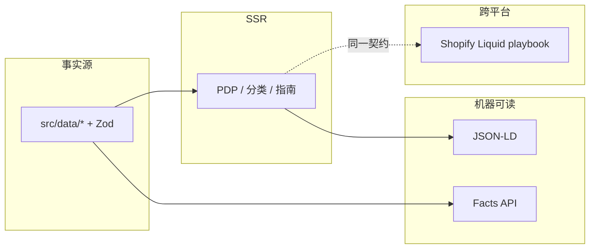

<p align="center">
  
</p>

<p align="center">
  <strong>峰途 TrailForge</strong> · 可 fork 的 <b>SEO + GEO</b> 电商参考商店（Next.js · MIT）
</p>

<p align="center">
  <a href="https://github.com/GosuQuan/seo-geo-commerce/actions"></a>
  <a href="./LICENSE"></a>
  <a href="https://nextjs.org/"></a>
  
  
  
  
  
</p>

<p align="center">
  <a href="#-快速开始">快速开始</a> ·
  <a href="#-功能矩阵">功能</a> ·
  <a href="#-动效实验室">动效实验室</a> ·
  <a href="#-架构">架构</a> ·
  <a href="#-shopify-复用">Shopify</a> ·
  <a href="#-技术博客">博客</a> ·
  <a href="#-live-demo">Demo</a>
</p>

---

## ✨ 它是什么？

这不是又一个 GEO 内容 CMS。本仓库是 **店面 + 共享工具库**：

| 传统做法 | 本 Demo |
|---------|---------|
| 页面文案与结构化数据两套稿 | `src/data/` **单一事实源** |
| 只优化十个蓝链 | 同时面向 **AI 答案引用（GEO）** |
| 黑盒「投喂」技巧 | Answer-first · FAQ · 规格表 · 可审计清单 |
| 难上线的玩具 | Docker · healthcheck · 严格 TypeScript |

> **重要：** Google **忽略** `llms.txt`。我们仍提供它给其他 Agent；**不要**把它当成 Google AI Overviews 的开关。Googlebot ≠ Google-Extended。

---

## 🚀 快速开始

```bash
git clone https://github.com/GosuQuan/seo-geo-commerce.git
cd seo-geo-commerce
cp .env.example .env.local
npm install
npm run dev
```

打开 [http://localhost:3000](http://localhost:3000)。

```bash
npm run build && npm run start   # 生产
npm run typecheck && npm run lint
docker compose up --build        # 近生产一键起
# 健康检查：GET /api/health
```

环境变量见 `.env.example`（`SITE_URL` · `SITE_NAME` · `SITE_LOCALE`）。

---

## 🌐 Live Demo

| | |
|--|--|
| 🏠 首页 | http://117.72.122.109/trailforge |
| 👟 旗舰 PDP | http://117.72.122.109/trailforge/products/ridgewalk-gtx-mid |
| 🧭 Shopify 实践指南 | http://117.72.122.109/trailforge/guides/shopify-seo-geo |
| 📊 GEO 审计 | http://117.72.122.109/trailforge/audit |
| ✨ 动效实验室 | http://117.72.122.109/trailforge/effects |
| 🧾 Facts API | http://117.72.122.109/trailforge/api/facts/ridgewalk-gtx-mid |

> IP Demo（路径前缀 `/trailforge`）。生产请换自定义域 + HTTPS。2G 小机勿在服务器上硬编大构建。

---

## 🧩 功能矩阵

```text
┌──────────────┬─────────────────────────────────────────────────────┐
│ 店面         │ /products · /categories · /guides · /about · /audit │
│ 动效实验室   │ /effects · 8 库按路由懒加载（Motion/GSAP/Lottie/…）   │
│ SEO          │ metadata · sitemap · robots · 丰富 JSON-LD          │
│ GEO          │ Answer-first · FAQ · Facts API · crawler policy     │
│ Shopify 桥   │ SeoBridgeCallout · /guides/shopify-seo-geo          │
│ 文档         │ Playbook · Liquid snippets · Architecture           │
└──────────────┴─────────────────────────────────────────────────────┘
```

### 店面路由

- `/` 首页（企业级动效：滚动进度条 · 数字递增 · Hero 视差 · 分区 blur 入场 · 商品卡 3D tilt · 特性 Marquee；`useReducedMotion` 全覆盖） · `/products` · `/products/[slug]` PDP（含 Shopify 映射彩条）
- `/categories/[slug]` 分类买家指南
- `/guides/*` 含 **Shopify SEO/GEO 实践**、新手装备、防水等级
- `/audit` 清单打分
- `/effects` **动效实验室**（8 个子演示，懒加载）

### SEO

- `generateMetadata`（canonical / OG / Twitter）
- `app/sitemap.ts` · `app/robots.ts`
- JSON-LD：Organization · WebSite · BreadcrumbList · Product+Offer+AggregateRating · FAQPage · ItemList · Article

### GEO

- Answer-first（PDP / 分类 / 指南）
- 规格表 ↔ JSON-LD ↔ Facts API **同源**
- `src/config/crawlers.ts`（search vs training）
- `GET /api/products` · `/api/facts/[slug]`
- `/audit` + [`docs/geo-prompt-panel.md`](./docs/geo-prompt-panel.md)


---

## 🎬 首页企业动效

商店首页（`HomeExperience`）内置常见 B2B/品牌站动效模式（`motion/react`）：

| 模式 | 说明 |
|------|------|
| Scroll progress | 顶部 `scaleX` 跟随 `scrollYProgress` |
| Stats count-up | 商品/分类/JSON-LD/Audit 进入视口后数字递增 |
| Hero parallax | 光晕与标题随滚动分层位移 |
| Section reveal | `whileInView` + blur/fade（`once`） |
| Product tilt | 轻微透视跟随指针 |
| Feature marquee | Hero 下标签带，悬停暂停 |

`prefers-reduced-motion` 时关闭视差/递增动画/跑马灯，文案始终在 DOM 中可见（不永久 `opacity: 0`）。

更重的库演示仍在 [`/effects`](./docs/blog/animation-libs.md) **按路由懒加载**。

---

## ✨ 动效实验室

可商用开源动效 **全量进 Demo**，但 **按路由懒加载**——商店首页不会背负 Three.js。

| 路由 | 库 | 许可 |
|------|----|------|
| [`/effects`](http://localhost:3000/effects) | Hub 彩色卡片 | — |
| `/effects/motion` | [Motion](https://motion.dev/) | MIT |
| `/effects/gsap` | [GSAP](https://gsap.com/) core | 核心可商用* |
| `/effects/lottie` | [lottie-react](https://www.npmjs.com/package/lottie-react) | MIT |
| `/effects/auto-animate` | [Auto-Animate](https://auto-animate.formkit.com/) | MIT |
| `/effects/spring` | [React Spring](https://www.react-spring.dev/) | MIT |
| `/effects/animate-css` | [Animate.css](https://animate.style/) | MIT（仅该页引入 CSS） |
| `/effects/tailwind` | Tailwind `@keyframes` | MIT |
| `/effects/r3f` | Three.js + R3F + drei | MIT |

\* GSAP 部分 Club 插件需付费授权；本仓库 Demo **只依赖 `gsap` 核心**。详见 [docs/blog/animation-libs.md](./docs/blog/animation-libs.md)。

```bash
npm run dev
# 打开 http://localhost:3000/effects
```

实现要点：`src/components/effects/Lazy*.tsx` → `next/dynamic(..., { ssr: false })`。

---

## 🏗 架构



更完整图示：[docs/ARCHITECTURE.md](./docs/ARCHITECTURE.md)

```text
src/
  app/          # App Router 页面与 API
  components/   # AnswerFirst · SpecsTable · FaqList · SeoBridgeCallout · effects/*
  config/       # site.ts · crawlers.ts
  data/         # 商品/分类/指南 + Zod
  lib/seo|geo/  # metadata · jsonld · audit · facts
docs/
  blog/         # 技术长文 + Liquid 片段
  assets/       # README 动效 banner
  geo-prompt-panel.md
```

---

## 🛒 Shopify 复用

**复用策略，不复用 React 源码。**

| Demo 字段 | Shopify |
|-----------|---------|
| `answerFirst` | `metafields.seo.answer_first` |
| `specs[]` | `metafields.specs.*` |
| `faqs[]` | `metafields.seo.faq` |
| Product JSON-LD | Liquid snippet（见博客） |
| `/api/facts` | Storefront API / App Proxy |

站内指南：[`/guides/shopify-seo-geo`](http://117.72.122.109/trailforge/guides/shopify-seo-geo)  
每个 PDP / 分类页底部有彩色 **SeoBridgeCallout** 对照表。

---

## 📚 技术博客

| 文章 | 说明 |
|------|------|
| [SEO + GEO 电商实战手册](./docs/blog/seo-geo-ecommerce-playbook.md) | 原则 · 文件映射 · 测量 · 上线清单（中文为主） |
| [Shopify Liquid 片段](./docs/blog/shopify-liquid-snippets.md) | Answer-first / JSON-LD / FAQ / 集合页可复制代码 |
| [ARCHITECTURE](./docs/ARCHITECTURE.md) | Mermaid 架构图 |
| [GEO 提示词面板](./docs/geo-prompt-panel.md) | 固定提示词测 AI 引用 |

---

## ⚠️ Caveats

- Demo 评价分为虚构但自洽数据，上线请换真实源。
- `llms.txt` **不是** Google 官方信号。
- Disallow `Google-Extended` 不影响经典搜索收录。
- GEO 无银弹：公开可抓取、事实清晰、实体一致，比堆词重要。

---

## 🤝 贡献

见 [CONTRIBUTING.md](./CONTRIBUTING.md)。Issue / PR 欢迎。

---

## 📄 License

[MIT](./LICENSE) © contributors

---

## English summary

**seo-geo-commerce** is a production-oriented **reference storefront + toolkit** for SEO and Generative Engine Optimization. Fork it for outdoor / specialty e-commerce:

- Next.js 15 App Router · Chinese demo catalog · Zod single source of truth  
- JSON-LD · robots policy · `/api/facts` · GEO audit UI  
- **Shopify playbook** with copy-paste Liquid snippets  
- **Effects Lab** (`/effects`) — Motion, GSAP, Lottie, Auto-Animate, Spring, Animate.css, Tailwind, R3F (route-lazy)  
- Docker Compose · colorful docs for GitHub showcase  

```bash
npm install && npm run dev
# or
docker compose up --build
```

Live IP demo: http://117.72.122.109/trailforge
