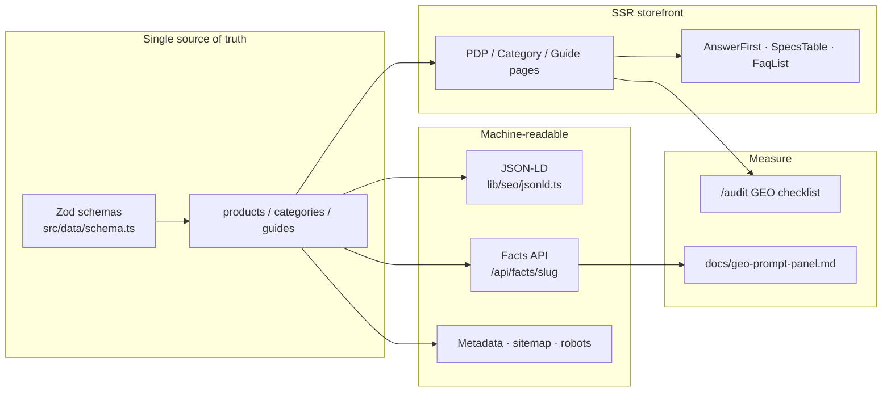
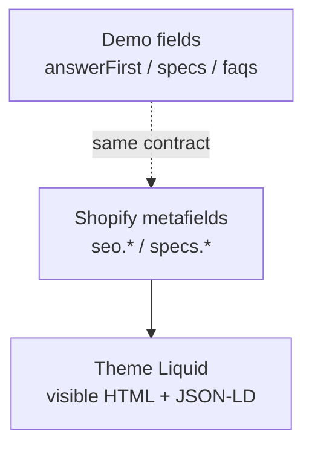

# Architecture

## High-level

## Shopify bridge

## Key paths

| Path | Role |
|------|------|
| `src/data/*` | Catalog facts |
| `src/lib/seo/*` | Metadata + JSON-LD |
| `src/lib/geo/*` | Answer-first helpers, audit, facts DTO |
| `src/config/crawlers.ts` | Search vs training bot policy |
| `docs/blog/*` | Playbook + Liquid 精简对照 |
| `docs/shopify/*` | Enterprise Liquid delivery pack |
| `docs/enterprise-delivery-highlights.md` | 企业交付亮点（中文） |

